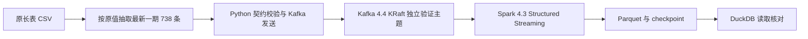

# 第一天完成报告

日期：2026-11-24（北京时间）

项目目录：`D:/bigdata`

私有仓库：https://github.com/StephenYI43/chengdu-market-prices

## 验收结论

第一天的环境、工程骨架、数据字典、消息与接口契约，以及真实样例的流处理链路已完成。本机实测命令退出码为0，结果为 `passed: true`。



这次使用 Structured Streaming 的 `availableNow` 触发方式消费一批已到达数据，验证后进程退出。持续运行、断点恢复、增量去重和处理延迟监控属于后续功能，首日结果不代表已经完成常驻实时服务。

## 数据确认

| 项目 | 实际结果 |
|---|---|
| 原始长表 | `D:/bigdatasource/成都农贸市场价格_近两年_长表.csv` |
| 日期范围 | 2024-11-26 至 2026-11-24 |
| 报价频率 | 105期，每期相隔7天，均为周二 |
| 原始记录 | 75,726条 |
| 有效数值价格 | 75,564条 |
| 无报价 | 162条，原值为 `-` |
| 监测范围 | 6个原始区分组、18个市场、40个商品名称 |
| 最新一期样例 | 2026-11-24，738条，其中737条有价格、1条无报价 |

完整长表SHA-256：

```text
27fecbd0113f3491ad4b27aef8e533837801bc99c1edfff3fcaa513658e718c6
```

样例CSV SHA-256：

```text
659c6ebcfa37358ec668ea051fdd57b267e306cb82011e1ca9d0ff224f58acf0
```

原始文件未修改。样例是完整一期的原值抽取，没有随机生成、插值或改写价格。消息明确标记为 `historical_replay`，业务日期与处理时间分开保存。

来源为用户提供的采集结果，标注来自成都市发改委市场价格栏目。尚未逐期对照官网原文。完整统计见 [manifest.json](../data/samples/manifest.json)，字段口径见 [数据字典](data-dictionary.md)。源数据按周更新，后续预测采用周度预测；页面推送及时显示新一期的处理结果。

## 已落实的技术与工程

| 层次 | 本次版本或产物 |
|---|---|
| 容器环境 | Docker Desktop、WSL2、Linux容器 |
| 流消息 | Apache Kafka 4.4.0，单节点KRaft，镜像摘要锁定 |
| 流计算 | Apache Spark 4.3.0，官方镜像，JDK 21.0.13 |
| Python | 3.13.18，uv 0.13.9管理，依赖锁定于 `uv.lock` |
| 后端 | FastAPI 0.165.0、Pydantic 2.14.4 |
| 数据存储与查询 | Parquet、PyArrow 26.0.1、DuckDB 2.0.1 |
| 前端骨架 | React 19.3.1、TypeScript 7.0.2、Vite 8.3.8 |
| 前端工具 | Node 24、pnpm 11.13.0、`pnpm-lock.yaml` |
| 协作 | Git、GitHub私有仓库、源码检查工作流 |

Spark在容器中通过 `spark-submit` 运行；本地Python环境不重复安装PySpark。预测依赖仅预留独立的 `ml` 依赖组，尚未安装或训练模型。

## 本机实测证据

执行命令：

```powershell
powershell -NoProfile -File scripts/verify-day1.ps1 -RunId 20261124-day1-verified
```

验证主题：`price.day1.20261124-day1-verified`。实际结果：

| 检查项 | 结果 |
|---|---|
| Kafka确认发送 | 738条 |
| Spark落地行数 | 738条 |
| 有效价格 / 无报价 | 737 / 1 |
| 唯一业务键 | 738个 |
| 事件ID集合与逐条全部载荷字段 | 一致 |
| 原始报价日期、历史回放标识 | 一致 |
| 无报价与null语义、正数价格 | 通过 |
| DuckDB直接读取Parquet计数 | 738行、737个非空价格 |
| 流处理验收 | 11项检查全部通过 |

传输控制合计为6593.7000，仅用于核对完整性。不同单位的价格合计不能解释为消费支出或价格指数。

本机详细产物保存在 `artifacts/day1/20261124-day1-verified/`：包括确认发送的事件、Parquet、checkpoint和 `verification.json`。简要结果另存于 [验收证据](evidence/day1-verification.json)，随源码提交。

其他验证：

- 后端10项测试通过，覆盖真实样例完整性、价格缺失语义、消息约束与接口契约。
- Ruff检查、格式检查和Python编译检查通过。
- 前端TypeScript检查和Vite生产构建通过。当前是工程占位页，尚未进行完整业务页面验收。
- 本机 `/health/live`、`/health/ready`、`/api/v1/metadata` 均返回200；真实报价提交到契约校验接口返回200且事件ID一致。
- GitHub工作流负责重复执行源码测试与前端构建；Kafka/Spark整链路证据来自本机Docker实测。

## 运行与复现

```powershell
# 启动后端和Kafka；首次或修改源码后构建镜像
docker compose up -d --build kafka api

# 用新的批次标识重复整链路验证
powershell -NoProfile -File scripts/verify-day1.ps1

# 本机源码检查
.tools/bin/uv.exe run pytest -q
.tools/bin/uv.exe run ruff check .
.tools/bin/uv.exe run ruff format --check .

# 前端构建
cd frontend
pnpm build
```

本机接口文档：http://127.0.0.1:18880/docs 。Kafka宿主机入口为 `127.0.0.1:19092`。8000和18000被现有打印服务占用，因此本项目采用18880。未停止其他项目的容器，也未更改其端口。

本机uv位于 `D:/bigdata/.tools/bin/uv.exe`，Python位于项目托管目录，开发虚拟环境为 `.venv`。其他电脑可先安装uv和pnpm，再根据锁文件安装依赖。首次Spark验证会从Maven Central下载连接器，之后复用本项目Ivy卷。

Kafka和API目前保持运行，临时Spark验证容器已自动退出。停止本项目：

```powershell
docker compose stop
```

## 第二天接续任务

1. 对全量75,726条数据执行可追溯清洗，保留原始值与缺失原因。
2. 建立商品、规格、单位、区和市场维表，区分标点差异与真正的品牌/等级变化。
3. 检查每条商品序列的周覆盖、规格变更、重复业务键和异常变化。
4. 生成清洗后的Parquet及商品周度汇总，落实跨市场比较口径。
5. 输出适合预测的序列清单，为后续无泄漏时间回测准备数据。

历史分析页面、持续实时处理、新一期采集、SSE推送、预测训练和业务预警尚未实现，按后续日程推进。
